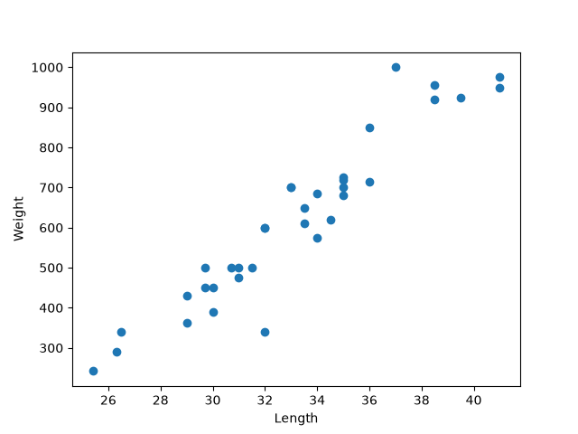
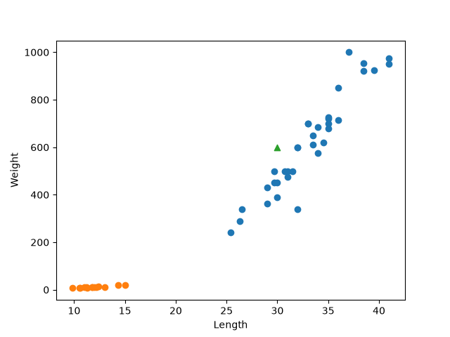
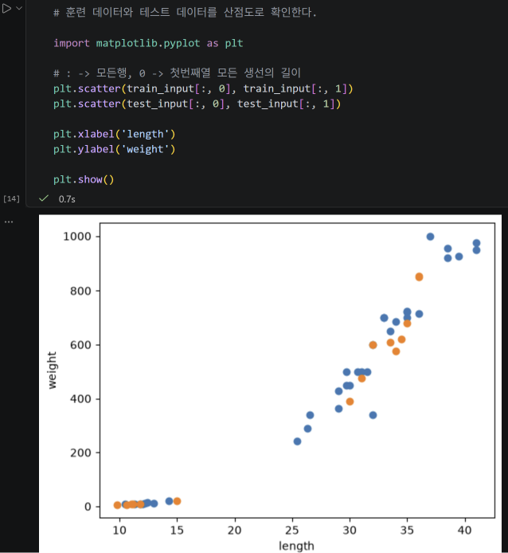

# 온라인 Python 수업

온라인 수업에서 진행한 Python 실습 코드를 정리합니다.

---

## Week 01 - k-최근접 이웃

### 배운 내용

- 머신러닝 기본 개념
- 분류와 이진 분류
- 도미와 빙어 데이터 시각화
- `zip()`과 리스트 내포를 이용한 데이터 구성
- 지도학습과 비지도학습
- k-최근접 이웃 알고리즘
- `fit()`, `score()`, `predict()`
- `n_neighbors` 값에 따른 분류 결과 변화

### 실습 코드

[week01_knn.ipynb](./week01_knn.ipynb)

도미 35마리와 빙어 14마리의 길이와 무게 데이터를 이용하여  
`KNeighborsClassifier`로 생선을 분류하고 새로운 생선을 예측하는 실습을 진행했다.  
또한 `n_neighbors=49`로 변경하여 이웃의 개수가 분류 결과에 미치는 영향을 확인했다.

### 실습 결과

#### 1. 도미 데이터 산점도

도미의 길이와 무게의 관계를 산점도로 확인했다.

#### 2. 도미와 빙어 데이터 비교

도미와 빙어의 길이와 무게 데이터를 같은 산점도에 표시하여  
두 데이터의 분포 차이를 확인했다.

#### 3. 새로운 생선 예측

길이 30cm, 무게 600g인 새로운 생선을 산점도에 표시하고  
k-최근접 이웃 모델을 이용하여 도미인지 빙어인지 예측했다.

### 주요 함수

| 함수 | 내용 |
|---|---|
| `plt.scatter()` | 산점도 출력 |
| `KNeighborsClassifier()` | k-최근접 이웃 분류기 생성 |
| `fit()` | 모델 학습 |
| `score()` | 모델 성능 측정 |
| `predict()` | 새로운 데이터 예측 |

---

## Week 02 - 훈련 데이터와 테스트 데이터

### 배운 내용

- 훈련 데이터와 테스트 데이터의 역할
- 훈련 세트와 테스트 세트 분리
- 샘플링 편향
- NumPy 배열 사용
- `shape`를 이용한 배열 크기 확인
- `np.arange()`를 이용한 인덱스 생성
- `np.random.shuffle()`을 이용한 데이터 섞기
- NumPy 배열 인덱싱
- 훈련 데이터와 테스트 데이터로 모델 학습 및 평가

### 실습 코드

[week02_train_test.ipynb](./week02_train_test.ipynb)

1주차에서 사용한 도미와 빙어 데이터를 훈련 데이터와 테스트 데이터로 나누어  
k-최근접 이웃 모델을 학습하고 성능을 평가했다.

데이터를 순서대로 나누었을 때 발생하는 샘플링 편향을 확인하고,  
NumPy를 이용하여 데이터를 섞은 뒤 다시 훈련 세트와 테스트 세트를 구성했다.

### 실습 결과

#### 1. 샘플링 편향 확인

도미 35마리만 훈련 데이터로 사용하고 빙어 14마리를 테스트 데이터로 사용했을 때  
모델의 정확도가 `0.0`으로 나타나는 것을 확인했다.

이는 훈련 데이터와 테스트 데이터가 특정 클래스에 치우쳐 발생한  
**샘플링 편향** 때문이다.

#### 2. 훈련 데이터와 테스트 데이터 분포 확인

NumPy를 이용하여 데이터의 인덱스를 무작위로 섞은 뒤  
훈련 데이터와 테스트 데이터를 산점도로 확인했다.

#### 3. 데이터 재학습 및 평가

섞인 데이터를 이용하여 모델을 다시 학습하고  
테스트 데이터로 성능을 평가한 결과 정확도 `1.0`을 확인했다.

### 주요 함수

| 함수 | 내용 |
|---|---|
| `np.array()` | Python 리스트를 NumPy 배열로 변환 |
| `.shape` | 배열의 형태와 크기 확인 |
| `np.arange()` | 일정 범위의 인덱스 생성 |
| `np.random.seed()` | 난수 생성 결과를 동일하게 고정 |
| `np.random.shuffle()` | 배열의 순서를 무작위로 섞음 |
| `fit()` | 훈련 데이터로 모델 학습 |
| `score()` | 테스트 데이터로 모델 성능 측정 |
| `predict()` | 입력 데이터의 클래스 예측 |

---