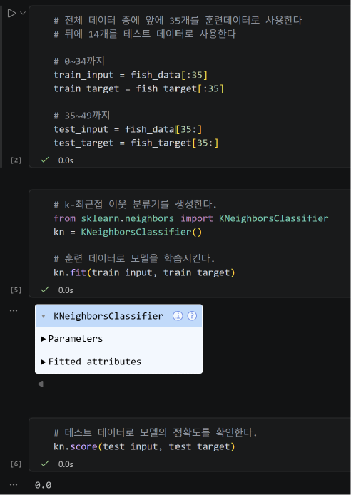
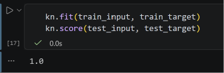
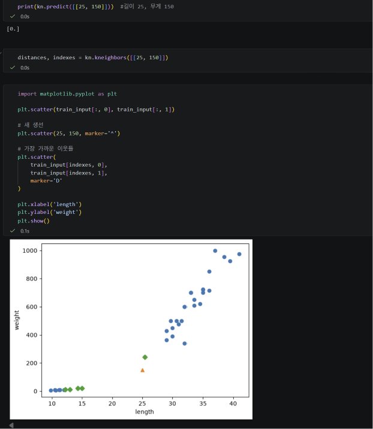
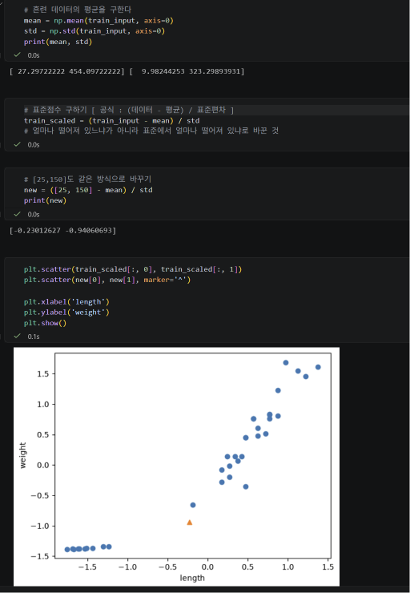
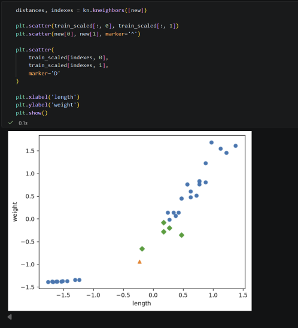

# 온라인 Python 수업

온라인 수업에서 진행한 Python 실습 코드를 정리합니다.

---

## Week 01 - k-최근접 이웃

### 배운 내용

- 머신러닝 기본 개념
- 분류와 이진 분류
- 도미와 빙어 데이터 시각화
- `zip()`과 리스트 내포를 이용한 데이터 구성
- 지도학습과 비지도학습
- k-최근접 이웃 알고리즘
- `fit()`, `score()`, `predict()`
- `n_neighbors` 값에 따른 분류 결과 변화

### 실습 코드

[week01_knn.ipynb](./week01_knn.ipynb)

도미 35마리와 빙어 14마리의 길이와 무게 데이터를 이용하여  
`KNeighborsClassifier`로 생선을 분류하고 새로운 생선을 예측하는 실습을 진행했다.  
또한 `n_neighbors=49`로 변경하여 이웃의 개수가 분류 결과에 미치는 영향을 확인했다.

### 실습 결과

#### 1. 도미 데이터 산점도

도미의 길이와 무게의 관계를 산점도로 확인했다.

#### 2. 도미와 빙어 데이터 비교

도미와 빙어의 길이와 무게 데이터를 같은 산점도에 표시하여  
두 데이터의 분포 차이를 확인했다.

#### 3. 새로운 생선 예측

길이 30cm, 무게 600g인 새로운 생선을 산점도에 표시하고  
k-최근접 이웃 모델을 이용하여 도미인지 빙어인지 예측했다.

### 주요 함수

| 함수 | 내용 |
|---|---|
| `plt.scatter()` | 산점도 출력 |
| `KNeighborsClassifier()` | k-최근접 이웃 분류기 생성 |
| `fit()` | 모델 학습 |
| `score()` | 모델 성능 측정 |
| `predict()` | 새로운 데이터 예측 |

---

## Week 02 - 훈련 데이터와 테스트 데이터

### 배운 내용

- 훈련 데이터와 테스트 데이터의 역할
- 훈련 세트와 테스트 세트 분리
- 샘플링 편향
- NumPy 배열 사용
- `shape`를 이용한 배열 크기 확인
- `np.arange()`를 이용한 인덱스 생성
- `np.random.shuffle()`을 이용한 데이터 섞기
- NumPy 배열 인덱싱
- 훈련 데이터와 테스트 데이터로 모델 학습 및 평가

### 실습 코드

[week02_train_test.ipynb](./week02_train_test.ipynb)

1주차에서 사용한 도미와 빙어 데이터를 훈련 데이터와 테스트 데이터로 나누어  
k-최근접 이웃 모델을 학습하고 성능을 평가했다.

데이터를 순서대로 나누었을 때 발생하는 샘플링 편향을 확인하고,  
NumPy를 이용하여 데이터를 섞은 뒤 다시 훈련 세트와 테스트 세트를 구성했다.

### 실습 결과

#### 1. 샘플링 편향 확인

도미만 훈련 데이터로 사용하고 빙어만 테스트 데이터로 사용했을 때
정확도가 `0.0`으로 나타나는 것을 확인했다.

#### 2. 훈련 데이터와 테스트 데이터 분포 확인

NumPy를 이용해 인덱스를 섞고,
훈련 데이터와 테스트 데이터가 적절히 분포되어 있는지 산점도로 확인했다.

#### 3. 데이터 재학습 및 평가

섞인 데이터를 이용하여 모델을 다시 학습하고
테스트 데이터로 평가한 결과 정확도 `1.0`을 확인했다.

### 주요 함수

| 함수 | 내용 |
|---|---|
| `np.array()` | Python 리스트를 NumPy 배열로 변환 |
| `.shape` | 배열의 형태와 크기 확인 |
| `np.arange()` | 일정 범위의 인덱스 생성 |
| `np.random.seed()` | 난수 생성 결과를 동일하게 고정 |
| `np.random.shuffle()` | 배열의 순서를 무작위로 섞음 |
| `fit()` | 훈련 데이터로 모델 학습 |
| `score()` | 테스트 데이터로 모델 성능 측정 |
| `predict()` | 입력 데이터의 클래스 예측 |

---

## Week 03 - 데이터 전처리

### 배운 내용

- NumPy를 이용한 생선 데이터 구성
- `train_test_split()`을 이용한 훈련 데이터와 테스트 데이터 분리
- `stratify`를 이용한 클래스 비율 유지
- k-최근접 이웃의 거리 계산
- `kneighbors()`를 이용한 가장 가까운 이웃 확인
- 특성별 데이터 스케일 차이
- 평균과 표준편차를 이용한 표준점수
- 데이터 전처리
- 전처리된 데이터로 모델 재학습 및 예측

### 실습 코드

[week03_data_preprocessing.ipynb](./week03_data_preprocessing.ipynb)

도미와 빙어의 길이와 무게 데이터를 NumPy 배열로 구성하고  
`train_test_split()`을 이용하여 훈련 데이터와 테스트 데이터로 나누었다.

길이 25cm, 무게 150g인 생선을 k-최근접 이웃으로 분류했을 때  
빙어(`0`)로 분류되는 현상을 확인하였다.

길이와 무게의 스케일 차이가 거리 계산에 영향을 주는 것을 확인하고,  
표준점수를 이용해 데이터를 전처리한 뒤 모델을 다시 학습하였다.

전처리 후 같은 생선이 도미(`1`)로 분류되는 것을 확인하였다.

### 실습 결과

#### 1. 전처리 전 가장 가까운 이웃 확인

길이 25cm, 무게 150g인 생선을 예측한 결과 빙어(`0`)로 분류되었다.

`kneighbors()`를 이용하여 모델이 선택한 가장 가까운 이웃을 확인한 결과,  
길이와 무게의 스케일 차이 때문에 예상과 다른 데이터들이 이웃으로 선택되는 것을 확인했다.

#### 2. 표준점수 적용

훈련 데이터의 평균과 표준편차를 구하고  
각 데이터에서 평균을 뺀 뒤 표준편차로 나누어 스케일을 맞췄다.

새로운 생선 `[25, 150]`에도 동일한 평균과 표준편차를 적용하였다.

#### 3. 전처리 후 예측 결과

표준점수로 변환한 데이터를 이용하여 모델을 다시 학습하였다.

전처리 전에는 빙어(`0`)로 분류되었던 `[25, 150]`이  
전처리 후에는 도미(`1`)로 분류되는 것을 확인하였다.

가장 가까운 이웃도 다시 확인하여 전처리 전과 결과를 비교하였다.

### 기존 노션 정리와 달라진 점

#### 1. 데이터 전처리 내용의 주차 변경

기존 노션에서는 Chapter 2 안에서

- 2-1 훈련 데이터와 테스트 데이터
- 2-2 데이터 전처리

형태로 이어서 정리되어 있었다.

현재 수업에서는 훈련 데이터와 테스트 데이터가 Week 02,  
데이터 전처리가 Week 03의 `3-1 데이터 다루기 : 데이터 전처리`로 분리되어 있다.

따라서 기존 노션의 `2-2 데이터 전처리` 부분을  
현재 GitHub에서는 Week 03 내용으로 정리한다.

#### 2. `np.row_stack()` 대신 `np.vstack()` 사용

기존 노션과 수업자료에서는 행 방향으로 배열을 연결할 때 다음 함수를 사용하였다.

`np.row_stack()`

하지만 현재 사용 중인 NumPy 2.x 환경에서는 `np.row_stack()`이 제거되어  
실행하면 `AttributeError`가 발생한다.

따라서 현재 실습에서는 다음 함수를 사용한다.

`np.vstack()`

두 함수는 모두 여러 배열을 행 방향으로 쌓는 목적으로 사용된다.

#### 3. 새로운 생선 데이터를 `[25, 150]`으로 통일

기존 노션에서는 새로운 생선을 예측하는 부분에

`[25, 158]`

이 사용되어 있지만, 이후 가장 가까운 이웃을 확인하는 부분에서는

`[25, 150]`

을 사용하고 있어 값이 서로 다르게 기록되어 있다.

이번 실습에서는 예측, 그래프 표시, `kneighbors()` 모두  
`[25, 150]`으로 통일하여 사용하였다.

### 주요 함수

| 함수 | 내용 |
|---|---|
| `np.column_stack()` | 배열을 열 방향으로 결합 |
| `np.vstack()` | 배열을 행 방향으로 결합 |
| `np.ones()` | 값이 모두 1인 배열 생성 |
| `np.zeros()` | 값이 모두 0인 배열 생성 |
| `np.full()` | 지정한 값으로 채운 배열 생성 |
| `np.concatenate()` | 여러 배열을 하나로 연결 |
| `train_test_split()` | 데이터를 훈련 데이터와 테스트 데이터로 분리 |
| `KNeighborsClassifier()` | k-최근접 이웃 분류기 생성 |
| `fit()` | 모델 학습 |
| `score()` | 모델 정확도 측정 |
| `predict()` | 새로운 데이터의 클래스 예측 |
| `kneighbors()` | 가장 가까운 이웃의 거리와 인덱스 반환 |
| `np.mean()` | 평균 계산 |
| `np.std()` | 표준편차 계산 |
| `plt.scatter()` | 산점도 출력 |

---