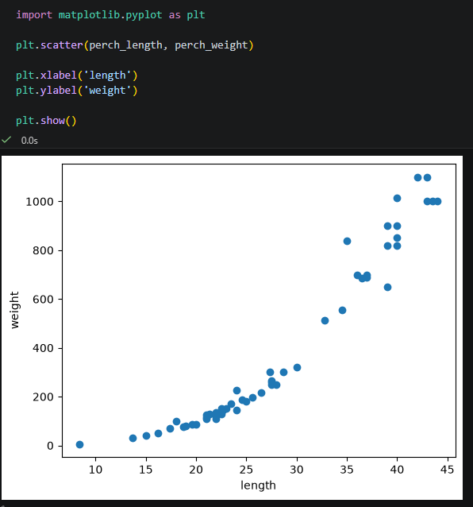
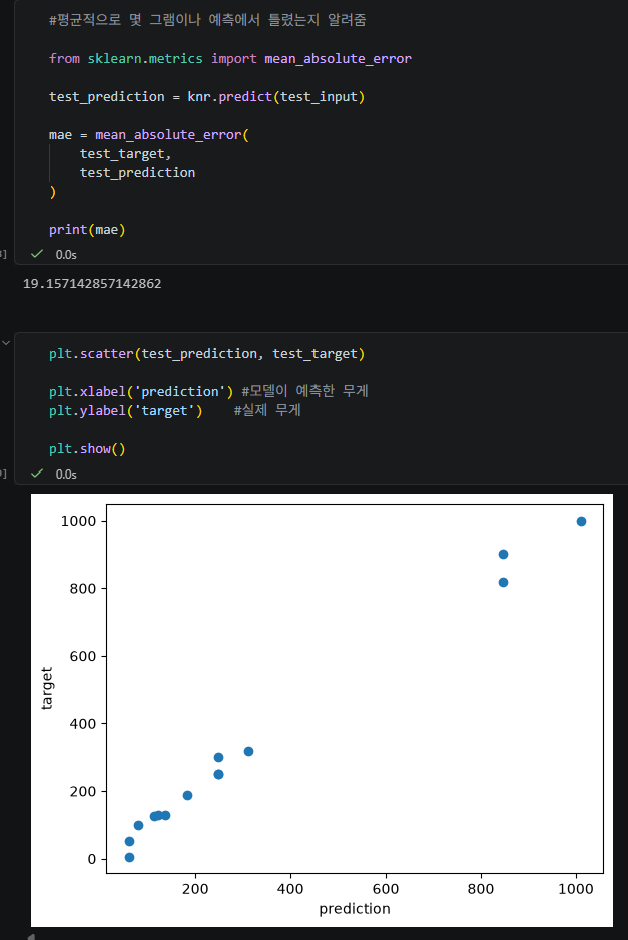
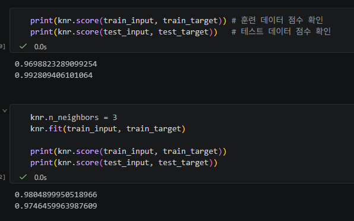
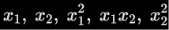
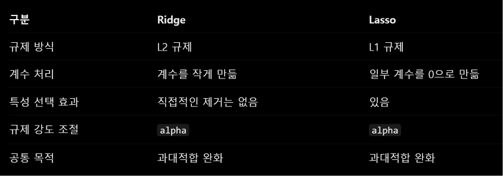
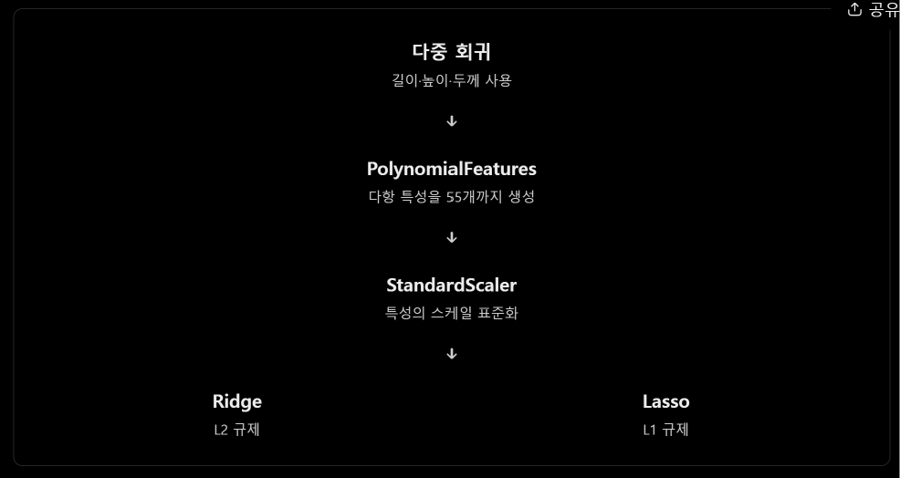

# 온라인 Python 수업

온라인 수업에서 진행한 Python 실습 코드를 정리합니다.

---

## Week 01 - k-최근접 이웃

### 배운 내용

- 머신러닝 기본 개념
- 분류와 이진 분류
- 도미와 빙어 데이터 시각화
- `zip()`과 리스트 내포를 이용한 데이터 구성
- 지도학습과 비지도학습
- k-최근접 이웃 알고리즘
- `fit()`, `score()`, `predict()`
- `n_neighbors` 값에 따른 분류 결과 변화

### 실습 코드

[week01_knn.ipynb](./week01_knn.ipynb)

도미 35마리와 빙어 14마리의 길이와 무게 데이터를 이용하여  
`KNeighborsClassifier`로 생선을 분류하고 새로운 생선을 예측하는 실습을 진행했다.  
또한 `n_neighbors=49`로 변경하여 이웃의 개수가 분류 결과에 미치는 영향을 확인했다.

### 실습 결과

#### 1. 도미 데이터 산점도

도미의 길이와 무게의 관계를 산점도로 확인했다.

#### 2. 도미와 빙어 데이터 비교

도미와 빙어의 길이와 무게 데이터를 같은 산점도에 표시하여  
두 데이터의 분포 차이를 확인했다.

#### 3. 새로운 생선 예측

길이 30cm, 무게 600g인 새로운 생선을 산점도에 표시하고  
k-최근접 이웃 모델을 이용하여 도미인지 빙어인지 예측했다.

### 주요 함수

| 함수 | 내용 |
|---|---|
| `plt.scatter()` | 산점도 출력 |
| `KNeighborsClassifier()` | k-최근접 이웃 분류기 생성 |
| `fit()` | 모델 학습 |
| `score()` | 모델 성능 측정 |
| `predict()` | 새로운 데이터 예측 |

---

## Week 02 - 훈련 데이터와 테스트 데이터

### 배운 내용

- 훈련 데이터와 테스트 데이터의 역할
- 훈련 세트와 테스트 세트 분리
- 샘플링 편향
- NumPy 배열 사용
- `shape`를 이용한 배열 크기 확인
- `np.arange()`를 이용한 인덱스 생성
- `np.random.shuffle()`을 이용한 데이터 섞기
- NumPy 배열 인덱싱
- 훈련 데이터와 테스트 데이터로 모델 학습 및 평가

### 실습 코드

[week02_train_test.ipynb](./week02_train_test.ipynb)

1주차에서 사용한 도미와 빙어 데이터를 훈련 데이터와 테스트 데이터로 나누어  
k-최근접 이웃 모델을 학습하고 성능을 평가했다.

데이터를 순서대로 나누었을 때 발생하는 샘플링 편향을 확인하고,  
NumPy를 이용하여 데이터를 섞은 뒤 다시 훈련 세트와 테스트 세트를 구성했다.

### 실습 결과

#### 1. 샘플링 편향 확인

도미만 훈련 데이터로 사용하고 빙어만 테스트 데이터로 사용했을 때
정확도가 `0.0`으로 나타나는 것을 확인했다.

#### 2. 훈련 데이터와 테스트 데이터 분포 확인

NumPy를 이용해 인덱스를 섞고,
훈련 데이터와 테스트 데이터가 적절히 분포되어 있는지 산점도로 확인했다.

#### 3. 데이터 재학습 및 평가

섞인 데이터를 이용하여 모델을 다시 학습하고
테스트 데이터로 평가한 결과 정확도 `1.0`을 확인했다.

### 주요 함수

| 함수 | 내용 |
|---|---|
| `np.array()` | Python 리스트를 NumPy 배열로 변환 |
| `.shape` | 배열의 형태와 크기 확인 |
| `np.arange()` | 일정 범위의 인덱스 생성 |
| `np.random.seed()` | 난수 생성 결과를 동일하게 고정 |
| `np.random.shuffle()` | 배열의 순서를 무작위로 섞음 |
| `fit()` | 훈련 데이터로 모델 학습 |
| `score()` | 테스트 데이터로 모델 성능 측정 |
| `predict()` | 입력 데이터의 클래스 예측 |

---

## Week 03 - 데이터 전처리

### 배운 내용

- NumPy를 이용한 생선 데이터 구성
- `train_test_split()`을 이용한 훈련 데이터와 테스트 데이터 분리
- `stratify`를 이용한 클래스 비율 유지
- k-최근접 이웃의 거리 계산
- `kneighbors()`를 이용한 가장 가까운 이웃 확인
- 특성별 데이터 스케일 차이
- 평균과 표준편차를 이용한 표준점수
- 데이터 전처리
- 전처리된 데이터로 모델 재학습 및 예측

### 실습 코드

[week03_data_preprocessing.ipynb](./week03_data_preprocessing.ipynb)

도미와 빙어의 길이와 무게 데이터를 NumPy 배열로 구성하고  
`train_test_split()`을 이용하여 훈련 데이터와 테스트 데이터로 나누었다.

길이 25cm, 무게 150g인 생선을 k-최근접 이웃으로 분류했을 때  
빙어(`0`)로 분류되는 현상을 확인하였다.

길이와 무게의 스케일 차이가 거리 계산에 영향을 주는 것을 확인하고,  
표준점수를 이용해 데이터를 전처리한 뒤 모델을 다시 학습하였다.

전처리 후 같은 생선이 도미(`1`)로 분류되는 것을 확인하였다.

### 실습 결과

#### 1. 전처리 전 가장 가까운 이웃 확인

길이 25cm, 무게 150g인 생선을 예측한 결과 빙어(`0`)로 분류되었다.

`kneighbors()`를 이용하여 모델이 선택한 가장 가까운 이웃을 확인한 결과,  
길이와 무게의 스케일 차이 때문에 예상과 다른 데이터들이 이웃으로 선택되는 것을 확인했다.

#### 2. 표준점수 적용

훈련 데이터의 평균과 표준편차를 구하고  
각 데이터에서 평균을 뺀 뒤 표준편차로 나누어 스케일을 맞췄다.

새로운 생선 `[25, 150]`에도 동일한 평균과 표준편차를 적용하였다.

#### 3. 전처리 후 예측 결과

표준점수로 변환한 데이터를 이용하여 모델을 다시 학습하였다.

전처리 전에는 빙어(`0`)로 분류되었던 `[25, 150]`이  
전처리 후에는 도미(`1`)로 분류되는 것을 확인하였다.

가장 가까운 이웃도 다시 확인하여 전처리 전과 결과를 비교하였다.

### 기존 노션 정리와 달라진 점

#### 1. 데이터 전처리 내용의 주차 변경

기존 노션에서는 Chapter 2 안에서

- 2-1 훈련 데이터와 테스트 데이터
- 2-2 데이터 전처리

형태로 이어서 정리되어 있었다.

현재 수업에서는 훈련 데이터와 테스트 데이터가 Week 02,  
데이터 전처리가 Week 03의 `3-1 데이터 다루기 : 데이터 전처리`로 분리되어 있다.

따라서 기존 노션의 `2-2 데이터 전처리` 부분을  
현재 GitHub에서는 Week 03 내용으로 정리한다.

#### 2. `np.row_stack()` 대신 `np.vstack()` 사용

기존 노션과 수업자료에서는 행 방향으로 배열을 연결할 때 다음 함수를 사용하였다.

`np.row_stack()`

하지만 현재 사용 중인 NumPy 2.x 환경에서는 `np.row_stack()`이 제거되어  
실행하면 `AttributeError`가 발생한다.

따라서 현재 실습에서는 다음 함수를 사용한다.

`np.vstack()`

두 함수는 모두 여러 배열을 행 방향으로 쌓는 목적으로 사용된다.

#### 3. 새로운 생선 데이터를 `[25, 150]`으로 통일

기존 노션에서는 새로운 생선을 예측하는 부분에

`[25, 158]`

이 사용되어 있지만, 이후 가장 가까운 이웃을 확인하는 부분에서는

`[25, 150]`

을 사용하고 있어 값이 서로 다르게 기록되어 있다.

이번 실습에서는 예측, 그래프 표시, `kneighbors()` 모두  
`[25, 150]`으로 통일하여 사용하였다.

### 주요 함수

| 함수 | 내용 |
|---|---|
| `np.column_stack()` | 배열을 열 방향으로 결합 |
| `np.vstack()` | 배열을 행 방향으로 결합 |
| `np.ones()` | 값이 모두 1인 배열 생성 |
| `np.zeros()` | 값이 모두 0인 배열 생성 |
| `np.full()` | 지정한 값으로 채운 배열 생성 |
| `np.concatenate()` | 여러 배열을 하나로 연결 |
| `train_test_split()` | 데이터를 훈련 데이터와 테스트 데이터로 분리 |
| `KNeighborsClassifier()` | k-최근접 이웃 분류기 생성 |
| `fit()` | 모델 학습 |
| `score()` | 모델 정확도 측정 |
| `predict()` | 새로운 데이터의 클래스 예측 |
| `kneighbors()` | 가장 가까운 이웃의 거리와 인덱스 반환 |
| `np.mean()` | 평균 계산 |
| `np.std()` | 표준편차 계산 |
| `plt.scatter()` | 산점도 출력 |

---

## Week 04 - k-최근접 이웃 회귀

### 배운 내용

- 분류와 회귀의 차이
- k-최근접 이웃 회귀
- `reshape()`를 이용한 2차원 입력 데이터 구성
- `KNeighborsRegressor`를 이용한 회귀 모델 학습
- 결정계수 R²를 이용한 회귀 모델 평가
- 평균 절대 오차 MAE
- 과대적합과 과소적합
- `n_neighbors` 조절을 통한 모델 복잡도 변화

### 실습 코드

[week04_knn_regression.ipynb](./week04_knn_regression.ipynb)

농어의 길이와 무게 데이터를 이용하여  
농어의 길이로부터 무게를 예측하는 k-최근접 이웃 회귀 모델을 학습하였다.

분류에서는 클래스를 예측했지만, 회귀에서는 농어의 무게와 같은 연속적인 수치를 예측한다.

`KNeighborsRegressor`는 새로운 데이터와 가까운 k개의 이웃을 찾고  
이웃들의 타깃값 평균을 이용하여 예측값을 결정한다.

또한 훈련 세트와 테스트 세트의 점수를 비교하여 과소적합 상태를 확인하고,  
이웃의 개수를 5개에서 3개로 줄여 모델의 복잡도를 조절하였다.

### 실습 결과

#### 1. 농어 길이와 무게의 관계

농어의 길이와 무게를 산점도로 나타내어  
길이가 증가할수록 무게도 전반적으로 증가하는 관계를 확인하였다.

#### 2. 회귀 모델 성능 평가

k-최근접 이웃 회귀 모델을 테스트 데이터로 평가한 결과  
결정계수 R²가 약 `0.993`으로 나타났다.

`mean_absolute_error()`를 이용하여 실제 무게와 예측 무게의 평균 차이도 확인했으며,  
평균 절대 오차는 약 `19.16g`이었다.

예측값과 실제값을 산점도로 비교하여  
모델의 예측 결과가 실제값과 어느 정도 일치하는지 확인하였다.

#### 3. 과소적합 확인 및 개선

기본 이웃 개수인 `5`를 사용했을 때 다음과 같은 점수가 나타났다.

- 훈련 데이터 R² : 약 `0.970`
- 테스트 데이터 R² : 약 `0.993`

훈련 데이터의 점수가 테스트 데이터보다 낮아  
현재 모델이 과소적합된 상태임을 확인하였다.

이웃의 개수를 `5`에서 `3`으로 줄이고 모델을 다시 학습한 결과

- 훈련 데이터 R² : 약 `0.980`
- 테스트 데이터 R² : 약 `0.975`

로 나타나 훈련 데이터와 테스트 데이터의 성능 차이가 줄어든 것을 확인하였다.

### 학습 핵심

#### 분류와 회귀

k-최근접 이웃 분류는 가장 가까운 이웃들의 클래스를 이용하여  
새로운 데이터가 어떤 클래스에 속하는지 판단한다.

k-최근접 이웃 회귀는 가장 가까운 이웃들의 타깃값을 평균하여  
새로운 데이터의 연속적인 수치를 예측한다.

#### `reshape(-1, 1)`

사이킷런에 입력할 데이터는 2차원 배열 형태가 필요하다.

따라서 농어의 길이처럼 1차원으로 구성된 데이터를

`reshape(-1, 1)`

을 이용하여 하나의 특성을 가진 2차원 배열로 변환하였다.

`-1`은 전체 데이터 개수에 맞게 행의 개수를 자동으로 계산한다는 의미이다.

#### 결정계수 R²

분류에서 `score()`가 정확도를 의미했던 것과 달리  
회귀 모델에서 `score()`는 결정계수 R²를 반환한다.

R²가 1에 가까울수록 모델의 예측 성능이 좋은 것으로 해석한다.

#### 과대적합과 과소적합

과대적합은 모델이 훈련 데이터에 지나치게 맞춰져  
훈련 데이터에서는 높은 성능을 보이지만 테스트 데이터에서는 성능이 낮아지는 상태이다.

과소적합은 모델이 너무 단순하여  
훈련 데이터의 특징을 충분히 학습하지 못한 상태이다.

k-최근접 이웃에서는 이웃의 개수에 따라 모델의 복잡도가 달라진다.

- 이웃의 개수를 줄이면 모델이 복잡해진다.
- 이웃의 개수를 늘리면 모델이 단순해진다.

이번 실습에서는 이웃의 개수를 `5`에서 `3`으로 줄여  
과소적합을 개선하였다.

### 주요 함수

| 함수 | 내용 |
|---|---|
| `reshape(-1, 1)` | 1차원 배열을 하나의 특성을 가진 2차원 배열로 변환 |
| `KNeighborsRegressor()` | k-최근접 이웃 회귀 모델 생성 |
| `score()` | 회귀 모델에서는 결정계수 R² 반환 |
| `mean_absolute_error()` | 실제값과 예측값의 평균 절대 오차 계산 |
| `n_neighbors` | 예측에 사용할 가까운 이웃의 개수 설정 |

---

## Week 05 - 선형 회귀와 다항 회귀

### 배운 내용

- k-최근접 이웃 회귀의 한계
- 선형 회귀(Linear Regression)
- `LinearRegression`을 이용한 모델 학습
- `coef_`, `intercept_`를 이용한 계수와 절편 확인
- 다항 회귀(Polynomial Regression)
- `np.column_stack()`을 이용한 다항 특성 생성
- 결정계수 R²를 이용한 모델 성능 비교

### 실습 코드

[week05_linear_polynomial_regression.ipynb](./week05_linear_polynomial_regression.ipynb)

농어의 길이와 무게 데이터를 이용하여 k-최근접 이웃 회귀의 한계를 확인하고, 선형 회귀와 다항 회귀 모델을 학습하였다.

기존 회귀 모델은 훈련 데이터 범위 밖의 농어를 정확하게 예측하기 어려웠다.

이를 개선하기 위해 직선의 방정식을 이용한 선형 회귀와 길이의 제곱을 추가한 다항 회귀를 비교하였다.

### 실습 결과

#### 1. k-최근접 이웃 회귀의 한계

50cm 농어의 예상 무게가 약 `1033g`으로 나타났으며, 길이가 더 커져도 예측값이 일정하게 유지되는 문제를 확인하였다.

#### 2. 선형 회귀 모델

`LinearRegression`으로 직선의 방정식을 학습하고 50cm 농어의 무게를 약 `1242g`으로 예측하였다.

- 훈련 R² : `0.940`
- 테스트 R² : `0.825`

#### 3. 다항 회귀 모델

길이의 제곱을 특성으로 추가하여 2차 방정식으로 학습하였다.

50cm 농어의 예측 무게는 약 `1574g`이었다.

- 훈련 R² : `0.971`
- 테스트 R² : `0.978`

### 학습 핵심

- **k-최근접 이웃 회귀** : 가까운 이웃의 평균으로 예측하므로 훈련 범위 밖의 예측에 한계가 있다.
- **선형 회귀** : `y = ax + b` 형태의 직선으로 데이터의 관계를 학습한다.
- **다항 회귀** : `y = ax² + bx + c` 형태로 곡선 관계를 표현한다.
- **모델 파라미터** : `coef_`는 회귀 계수, `intercept_`는 절편을 의미한다.

### 주요 함수

| 함수 | 내용 |
|---|---|
| `LinearRegression()` | 선형 회귀 모델 생성 |
| `fit()` | 모델 학습 |
| `predict()` | 새로운 데이터 예측 |
| `score()` | 결정계수 R² 반환 |
| `coef_` | 회귀 계수 확인 |
| `intercept_` | 절편 확인 |
| `np.column_stack()` | 배열을 열 방향으로 결합 |
| `np.arange()` | 일정 범위의 배열 생성 |
| `plt.plot()` | 직선 및 곡선 그래프 출력 |

---

## Week 06 - 다중 회귀와 규제

### 배운 내용

- 다중 회귀(Multiple Regression)의 개념
- Pandas를 이용한 CSV 데이터 불러오기
- 특성 공학(Feature Engineering)
- `PolynomialFeatures`를 이용한 다항 특성 생성
- 특성 개수 증가에 따른 과대적합
- `StandardScaler`를 이용한 데이터 표준화
- 릿지 회귀(Ridge)와 L2 규제
- 라쏘 회귀(Lasso)와 L1 규제
- `alpha` 조절에 따른 모델 성능 변화
- 하이퍼파라미터와 모델 파라미터의 차이

### 실습 코드

[week06_multiple_regression.ipynb](./week06_multiple_regression.ipynb)

농어의 길이, 높이, 두께 데이터를 이용하여 여러 특성을 사용하는 다중 회귀 모델을 학습하였다.

`PolynomialFeatures`를 이용해 기존 특성들을 조합하고, 2차와 5차 다항 특성을 생성하였다.

특성이 증가하면서 발생할 수 있는 과대적합을 확인하고, `StandardScaler`로 데이터를 표준화한 뒤 릿지와 라쏘 회귀를 적용하여 성능을 비교하였다.

### 실습 결과

#### 1. 다항 특성 생성

`PolynomialFeatures`를 사용하여 농어의 길이, 높이, 두께를 조합한 새로운 특성을 생성하였다.

- 기존 특성 : 3개
- 2차 다항 특성 : 9개
- 5차 다항 특성 : 55개

`include_bias=False`를 적용하여 편향 항을 제외하였다.

#### 2. 다중 회귀 모델 학습

2차 다항 특성을 이용하여 `LinearRegression` 모델을 학습하였다.

- 훈련 R² : `0.9903`
- 테스트 R² : `0.9715`

이후 5차 다항 특성 55개로 모델을 다시 학습하였다.

강의 PPT에서는 훈련 R²가 거의 `1.0`, 테스트 R²는 약 `-144.406`으로 나타나 심한 과대적합을 확인하였다.

현재 실습 환경에서는 훈련 R² `0.9954`, 테스트 R² `0.9780`으로 다른 결과가 나타났다.

#### 3. 실행 환경에 따른 결과 차이 확인

5차 다항 회귀에서 강의 PPT와 결과가 달라지는 원인을 분석하였다.

현재 환경에서 `LinearRegression`의 수치적 랭크는 `13`으로 확인되었다.

`scipy.linalg.lstsq()`의 특이값 허용 기준을 변경한 결과, 랭크에 따라 회귀 성능이 크게 달라지는 것을 확인하였다.

`cond=None`에서는 강의 PPT와 거의 동일한 테스트 R² `-144.4058`을 재현하였다.

이를 통해 다항 특성이 많을 때 수치적 랭크 판정이 모델의 예측 결과에 큰 영향을 줄 수 있다는 것을 확인하였다.

#### 4. 표준화 및 릿지 회귀

`StandardScaler`를 이용해 55개의 다항 특성을 표준화하였다.

표준화된 데이터에 `Ridge` 모델을 적용하여 L2 규제를 사용한 회귀 모델을 학습하였다.

강의 PPT 기준 기본 릿지 회귀 결과는 다음과 같다.

- 훈련 R² : `0.9896`
- 테스트 R² : `0.9791`

`alpha`를 `0.001`, `0.01`, `0.1`, `1`, `10`, `100`으로 변경하면서 훈련 및 테스트 점수를 비교하였다.

강의에서는 `alpha=0.1`일 때 테스트 R²가 약 `0.9828`로 나타났다.

#### 5. 라쏘 회귀

`Lasso` 모델을 이용하여 L1 규제를 적용하였다.

강의 PPT에서는 `alpha=10`으로 설정했을 때 다음 결과가 나타났다.

- 훈련 R² : `0.9888`
- 테스트 R² : `0.9824`

또한 `np.sum(lasso.coef_ == 0)`을 이용해 계수가 0인 특성을 확인하였다.

55개 특성 중 40개의 계수가 0으로 나타나 라쏘 회귀의 특성 선택 효과를 확인하였다.

### 학습 핵심

#### 다중 회귀와 특성 공학

다중 회귀는 여러 입력 특성을 이용하여 하나의 타깃값을 예측하는 방법이다.

특성 공학은 기존 특성을 조합하거나 변환하여 새로운 특성을 생성하는 작업이다.

`PolynomialFeatures`를 이용하면 제곱항과 특성 간 곱셈 항을 자동으로 생성할 수 있다.

#### 과대적합과 규제

특성의 개수가 지나치게 많아지면 훈련 데이터에 과도하게 맞춰지는 과대적합이 발생할 수 있다.

규제는 회귀 계수의 크기를 제한하여 모델의 복잡도를 조절하는 방법이다.

- **릿지(Ridge)** : L2 규제로 계수를 작게 만든다.
- **라쏘(Lasso)** : L1 규제로 일부 계수를 0으로 만들 수 있다.
- **alpha** : 규제 강도를 결정하는 하이퍼파라미터이다.

규제를 적용하기 전에는 `StandardScaler`로 특성의 스케일을 맞추는 것이 중요하다.

#### 릿지와 라쏘의 차이

릿지는 모든 특성을 유지하면서 계수의 크기를 줄이는 방식이다.

라쏘는 일부 계수를 0으로 만들어 불필요한 특성을 제거하는 효과가 있다.

두 모델 모두 과대적합을 완화하는 데 사용되며, `alpha`를 통해 규제 강도를 조절할 수 있다.

### 주요 함수

| 함수 | 내용 |
|---|---|
| `pd.read_csv()` | CSV 파일을 데이터프레임으로 불러오기 |
| `to_numpy()` | 데이터프레임을 NumPy 배열로 변환 |
| `PolynomialFeatures()` | 다항 특성 생성 |
| `get_feature_names_out()` | 생성된 특성 이름 확인 |
| `StandardScaler()` | 데이터를 표준점수로 변환 |
| `LinearRegression()` | 선형 회귀 모델 생성 |
| `Ridge()` | L2 규제를 적용한 회귀 모델 |
| `Lasso()` | L1 규제를 적용한 회귀 모델 |
| `alpha` | 규제 강도 설정 |
| `np.log10()` | 상용로그 계산 |
| `np.sum()` | 배열 원소의 합 계산 |
| `coef_` | 학습된 회귀 계수 확인 |
| `score()` | 결정계수 R² 계산 |

---